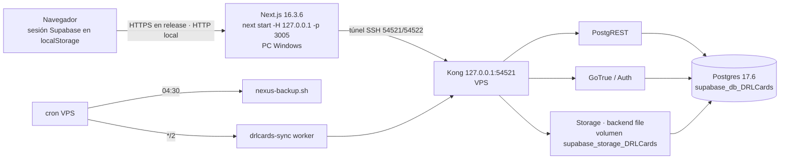

# DRLCards · Operación en producción

> Estado a 2026-09-26 (F67). **No hay despliegue público.** La app corre en el PC del operador y la base de datos en el VPS. Todos los comandos son reales; no contienen secretos.

## 1. Arquitectura real



- VPS: `212.95.40.144`, usuario `nexusadmin`, clave `~/.ssh/id_ed25519`. Stack Docker `supabase_*_DRLCards` con 12 contenedores, `restart=unless-stopped`, puertos solo en `127.0.0.1`.
- No hay app DRLCards en el VPS: `next start` corre en el PC.
- Tiempo real: no se usa (HTTP + sondeo). Correo: GoTrue → Inbucket (capturador local), así que **no se entregan correos reales**.

## 2. Dependencias

| Nivel | Qué |
|---|---|
| **CRÍTICA** | Node 22.12–24.x · Postgres · GoTrue · `NEXT_PUBLIC_SUPABASE_URL` · `NEXT_PUBLIC_SUPABASE_ANON_KEY` · `SUPABASE_SERVICE_ROLE_KEY` · `.next` (build) · `public/` |
| DEGRADADA | Storage (0 objetos hoy) · `SYNC_SECRET` · worker esports · Google Fonts |
| OPCIONAL | `ANTHROPIC_API_KEY` · `NEXT_PUBLIC_VLR_API` · realtime/analytics/edge del stack |

## 3. Arrancar y parar (runtime persistente en el PC, F70.2)

DRLCards corre en el PC como **tarea programada «DRLCards»** del usuario, sin administrador y sin contraseñas guardadas. La tarea lanza un supervisor en PowerShell, así que no depende de ninguna terminal ni de una sesión de Claude: su padre es el servicio Task Scheduler (`svchost`).

```powershell
# desde C:\NEXUS-CENTRAL\DRLCards
$svc = "scripts\ops\windows\drlcards-service.ps1"
powershell -NoProfile -ExecutionPolicy Bypass -File $svc -Action install   # registrar/reinstalar la tarea y arrancar
powershell -NoProfile -ExecutionPolicy Bypass -File $svc -Action start
powershell -NoProfile -ExecutionPolicy Bypass -File $svc -Action stop
powershell -NoProfile -ExecutionPolicy Bypass -File $svc -Action restart
powershell -NoProfile -ExecutionPolicy Bypass -File $svc -Action status    # tarea, supervisor, :3005, túnel, /, health, ready, build servida, logs
powershell -NoProfile -ExecutionPolicy Bypass -File $svc -Action uninstall
```

- **Qué lanza:** `node node_modules\next\dist\bin\next start -H 127.0.0.1 -p 3005`, la build de `.next` tal cual (no reconstruye), escuchando **solo en 127.0.0.1**. Lee `.env.local` y no pasa secretos por argumentos.
- **Arranque automático:** al iniciar sesión el usuario. Arrancar con el equipo, antes de iniciar sesión, exigiría guardar una contraseña o usar SYSTEM; se descartó por mínimo privilegio.
- **Reinicio automático:**
  - Si la app muere, el supervisor la relanza (medido: 6,6 s; con caídas seguidas espera de 2 s hasta 60 s, para no entrar en bucle).
  - Si muere el supervisor, la tarea lo relanza en ≤ 1 min (disparador que se repite cada minuto con `IgnoreNew`). Entretanto la app sigue sirviendo, y el nuevo supervisor la adopta.
  - El «reiniciar si falla» de Task Scheduler NO relanza un proceso que muere; está medido, y por eso existe la repetición.
- **Instancia única:**
  - Hay un mutex del supervisor; una segunda copia sale sin hacer nada.
  - Si :3005 está ocupado por un `next start` de DRLCards, el supervisor lo adopta; si lo ocupa otro proceso, espera y lo registra. Nunca arranca un segundo.
- **Túnel SSH 54521/54522:** el supervisor lo levanta solo si el puerto está libre, con la clave de `~/.ssh` y `BatchMode`. No duplica un túnel existente.
- **Parada ordenada:** `stop` crea `logs\runtime\STOP`. El supervisor mata SOLO su árbol y sale. Mientras exista `STOP`, los relanzamientos de la tarea salen al instante. `start` lo borra.
- **Build nueva:** `stop` → `npm run build` → `start` → `status`. La build servida debe coincidir con `.next\BUILD_ID`.
- **Rollback:**
  - Para volver a la build anterior: `stop` → restaurar su `.next` (o el código y `npm run build`) → `start`.
  - Para volver al arranque manual de antes de F70.2: ejecuta `uninstall` y luego `npm run start` en una consola propia.
- **Verificación tras arrancar:** `status` (`/` 200, `/api/health` 200, `/api/ready` ready), después `npm run gate:browser` y `npm run production:check -- --app --vps`.
- **Arranque en frío medido:** liveness en 0,8 s y `ready` en 1,3 s.
- **Configuración incompleta:** en producción el proceso SALE con código 1 y el log dice qué variable falta (`[startup] … CRITICAL SUPABASE_SERVICE_ROLE_KEY: falta`).

## 4. Salud

| Ruta | Qué dice | Uso |
|---|---|---|
| `GET /api/health` | el proceso responde (`status`, `uptimeS`, `version`, `node`) | liveness / reinicio |
| `GET /api/ready` | `config` · `database` · `schema` (0058) · `privacy` (anon sin acceso a `profiles`, 0058) · `catalog` (331) · `storage` → `ready`/`degraded`/`not_ready` (503) | readiness / enviar tráfico |
| `/admin/system` (admin) | lo anterior + flags, economía, progresión, contenido, multijugador | diagnóstico |

- `/api/ready` guarda el resultado 15 s y ejecuta una sola sonda en vuelo, así que no se puede usar para cargar la base de datos.
- `npm run production:check -- --app --vps` hace la comprobación completa de una release sin escribir nada: env, huella del build, migraciones, flags, assets, secretos en el cliente, salud y backups.
- `npm run smoke:production` es el humo funcional y de seguridad, con cuentas QA.
- **Backups en production:check (`--vps`):**
  - Checks locales: `backup-daily-db` y `backup-daily-storage` (≤ 26 h), `backup-verified` (última unidad con manifiesto, de cualquier carpeta, con edad y `SHA256SUMS`), `backup-disk`.
  - **`backup-offsite`**, veredicto real de `src/domain/ops/backup.ts`:

    | Veredicto | Cuándo |
    |---|---|
    | FAIL `NOT_CONFIGURED` | sin configuración (hoy, a propósito) |
    | FAIL `DISABLED` | configuración presente pero desactivada |
    | FAIL `NEVER_VERIFIED` | activado, sin ninguna copia verificada |
    | FAIL `STALE` | la última copia verificada tiene más de 26 h |
    | WARN `LAST_RUN_FAILED` | hay copia reciente, pero el último envío falló |
    | PASS | copia **leída de vuelta** y verificada en las últimas 26 h |

  - La operativa y la activación están en `drlcards-backup-restore.md §7`.
- **Off-site y readiness:** son independientes a propósito. Una caída del proveedor de backups no toca `/api/ready` ni el juego: aparece en production:check, en el código de salida 3 de `backup-drlcards.sh` y en `/opt/nexus/logs/drlcards-offsite.log`.

## 5. Logs y diagnóstico

- **Formato:** una línea JSON por evento (`src/server/ops/log.ts`): `{t, level, scope, msg, errorId?, requestId?, …}`.
- **Correlación:**
  - Cada `/api/*` lleva `x-request-id`, que vuelve en la respuesta.
  - Un 500 devuelve «Algo ha fallado en el servidor. Código: XXXXXX»; el mismo código está en la línea de log.
  - Para localizarlo: `Select-String -Path app.log -Pattern XXXXXX`.
- **Redacción:** los campos `pass`/`token`/`secret`/`authorization`/`cookie`/`key`/`email`/`jwt` se escriben como `[redactado]`.
- **Rotación:** la app escribe en stdout/stderr, así que la rotación la hace quien la lance.
  - **PC (F70.2):** `logs\runtime\app.log`, rotado por `scripts\ops\windows\drlcards-logpipe.mjs` (10 MB × 5), y `logs\runtime\supervisor.log` (1 MB × 3). Ignorados por git.
  - Con systemd: journald (plantilla abajo).
  - Con redirección a fichero: `logrotate` diario, 14 copias, `copytruncate`.
- **Worker:** `/opt/nexus/projects/drlcards-sync/logs/esports-sync.log` rota a 5 MB (`.1`).
- **Backups:** `/opt/nexus/logs/nexus-backup.log`.

## 6. Gestión de procesos (para el host de producción, NO instalado)

`/etc/systemd/system/drlcards.service` (host Linux con Node 24 y el repo en `/opt/drlcards/app`):

```ini
[Unit]
Description=DRLCards (Next.js)
After=network-online.target docker.service
Wants=network-online.target

[Service]
Type=simple
User=drlcards
WorkingDirectory=/opt/drlcards/app
EnvironmentFile=/opt/drlcards/env/production.env
Environment=NODE_ENV=production
ExecStartPre=/usr/bin/npm run production:check
ExecStart=/usr/bin/node node_modules/next/dist/bin/next start -H 127.0.0.1 -p 3005
Restart=on-failure
RestartSec=5
StartLimitIntervalSec=120
StartLimitBurst=5
KillSignal=SIGTERM
TimeoutStopSec=20
NoNewPrivileges=true
ProtectSystem=full

[Install]
WantedBy=multi-user.target
```

- `production.env` debe tener permisos `600`, estar fuera del repo y contener las mismas variables que `.env.example`.
- Delante va un proxy TLS (Caddy o nginx) hacia `127.0.0.1:3005`. La app nunca se expone directamente.
- **Reinicio del VPS, lo que vuelve solo:** Docker (enabled), los 12 contenedores (`unless-stopped`) y el cron (backups y worker).
- **Lo que NO vuelve con el VPS:** el túnel y la app viven en el PC; allí los relanza la tarea «DRLCards» (§3).

## 7. Capacidad observada (PC → túnel → VPS)

- Concurrencia 1 a 50, solo lecturas:
  - 0 errores 5xx.
  - La meseta está en unas 60 RPS a partir de concurrencia 25.
  - p95 de 0,6 s con 10 y de 3 s con 50.
- **Cuello de botella:** cada consulta cruza el túnel (unos 100 ms). `/api/game/competitive` hace varias consultas seguidas (unos 530 ms con concurrencia 1).
- Con la app junto a la base de datos, esas latencias bajan a milisegundos.
- **Memoria:** estable (RSS de unos 285 MB bajo carga sostenida de 5 minutos, sin crecimiento). Los 429 son intencionales (cubeta por usuario).
- **Límite de la medición:** es de un solo proceso y un solo usuario QA; no es una cifra de «jugadores simultáneos».

## 8. Modo mantenimiento

- **Hoy no existe:** hay un `ErrorKind 'maintenance'` pero nada lo dispara. Mientras no haya tráfico público, una migración crítica se hace con la app parada.
- **Antes de la beta pública:** añadir un interruptor `NEXUS_MAINTENANCE=1` en `src/middleware.ts` que responda 503 con `Retry-After` a `/api/game/*` de escritura.

## 9. Interruptores

- **Constantes de código** (no se pueden conmutar desde el cliente): `GLOBAL_MARKET_ENABLED=false`, `PAYMENTS_ENABLED=false`.
- **Variables de entorno:**
  - `NEXUS_QA_HARNESS=1`: habilita `/design-system` en producción. Solo para QA local.
  - `NEXUS_PUBLIC_INDEXING=1` en el build: permite indexar el sitio.
  - `NEXUS_SANDBOX_CREDITS`: se ignora en producción.
  - `DRL_PUBLIC_RELEASE=1` (F70): modo público. Apagado = comportamiento actual. Ver §10.

## 10. SMTP y dominio (preparado, pendiente de datos)

Estado leído el 2026-09-28 (`scripts/ops/auth-config-status.sh`, sin secretos; detalle en `docs/product/qa/fase70-rc/auth-smtp-status.json`): `GOTRUE_SITE_URL=http://127.0.0.1:3000`, allow-list `https://127.0.0.1:3000`, SMTP = `supabase_inbucket_DRLCards:1025` (buzón local), `GOTRUE_MAILER_AUTOCONFIRM=true`. La recuperación de contraseña está implementada en código pero su correo no sale del VPS. **BLOCKED para release pública** hasta que el usuario aporte dominio, proveedor SMTP y credenciales (no se inventan).

**Variables exactas** (plantilla única: `.env.example`, bloque F70):

| Variable | Dónde vive | Valor |
|---|---|---|
| `DRL_PUBLIC_RELEASE` | app | `1` en la release pública |
| `NEXT_PUBLIC_SITE_URL` | app | `https://<dominio>` (= `GOTRUE_SITE_URL`) |
| `NEXT_PUBLIC_SUPABASE_URL` | app | `https://<host-api>` público (no `127.0.0.1:54521`) |
| `NEXUS_PUBLIC_INDEXING` | app (build) | `1` solo si se quiere indexar |
| `GOTRUE_SITE_URL`, `GOTRUE_URI_ALLOW_LIST`, `API_EXTERNAL_URL` | VPS, env de GoTrue (stack supabase-drlcards) | dominio/host público |
| `GOTRUE_MAILER_AUTOCONFIRM` | VPS, GoTrue | `false` |
| `GOTRUE_SMTP_HOST/PORT/USER/PASS/ADMIN_EMAIL/SENDER_NAME` | VPS, GoTrue | proveedor real; `PASS` solo en el VPS |
| `DRL_OFFSITE_*` | VPS, `offsite.env` | ver `backup-offsite.sh check-config` |

**Callbacks de Auth a permitir** (derivados de `src/lib/supabase/auth.tsx`): registro (`emailRedirectTo`) y recuperación (`resetPasswordForEmail` → `redirectTo`) vuelven ambos a `<origen>/cuenta`, donde el evento `PASSWORD_RECOVERY` abre el formulario de nueva contraseña. Allow-list mínima: `https://<dominio>/cuenta` (o `https://<dominio>/**`). No hay ruta `/auth/callback`.

**Plan cloudflared (reutilizando lo de NEXUS, sin instalar ni tocar DNS).** En este PC ya existe `cloudflared` (winget) con `~/.cloudflared/config.yml`: un túnel con ingress `clipflow.nexusclipflow.com → http://127.0.0.1:3000` y regla final `http_status:404`. La migración de NEXUS (`C:\NEXUS-CENTRAL\docs\migracion\NEXUS-INFRASTRUCTURE-MIGRATION.md`) prevé mover esos túneles al VPS (`/opt/nexus/projects/nexusedge`, preparado, sin arrancar). Para DRLCards bastaría una entrada más **antes** de la regla 404: `hostname: <dominio>` → `service: http://127.0.0.1:3005`, más la ruta DNS del túnel (`cloudflared tunnel route dns …`, paso del usuario). La app sigue ligada a `127.0.0.1`: cloudflared solo abre conexiones salientes. La API de Supabase necesita su propio hostname público (entrada al Kong del VPS, idealmente desde `nexusedge` en el VPS, no desde el PC por el túnel SSH). No se ha modificado nada fuera de este repo.

**HTTP→HTTPS y host canónico.** Cloudflare termina TLS; activar «Always Use HTTPS» y redirigir `www`/variantes al host canónico en el panel (paso del usuario). La app ya envía HSTS (`next.config.mjs`); `NEXT_PUBLIC_SITE_URL` y `GOTRUE_SITE_URL` deben ser exactamente el mismo origen.

**Salud a través del dominio.** `curl -fsS https://<dominio>/api/health` (vida) y `https://<dominio>/api/ready` (BD, esquema, privacidad). `/api/ready` NO depende del proveedor de copias fuera del VPS. Chequeo de release: `DRL_PUBLIC_RELEASE=1 BASE_URL=https://<dominio> npm run production:check -- --app --vps` → FAIL si SMTP es local (inbucket/mailpit/localhost), SITE_URL local o ≠ `NEXT_PUBLIC_SITE_URL`, allow-list local/vacía, autoconfirmación ON, offsite no verificado, o si falta `--vps`. Al arrancar en producción con el interruptor, un `NEXT_PUBLIC_SITE_URL`/`NEXT_PUBLIC_SUPABASE_URL` no https público aborta el proceso (exit 1).
